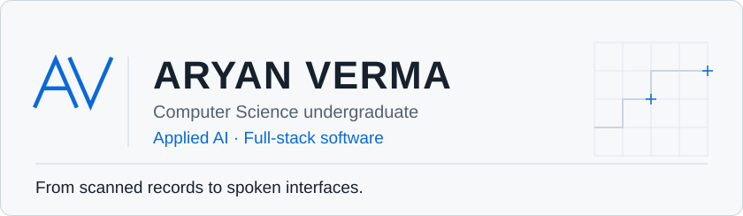

<picture>
  <source media="(prefers-color-scheme: dark) and (max-width: 600px)" srcset="assets/hero-dark-mobile.svg" />
  <source media="(prefers-color-scheme: light) and (max-width: 600px)" srcset="assets/hero-light-mobile.svg" />
  <source media="(prefers-color-scheme: dark)" srcset="dark_mode.svg" />
  <source media="(prefers-color-scheme: light)" srcset="light_mode.svg" />
  
</picture>

[Selected work](#selected-work) · [Stack](#technology) · [Portfolio](https://aryanverma21.vercel.app/) · [LinkedIn](https://www.linkedin.com/in/aryan-verma-509678346/) · [Email](mailto:verma4aryan4@gmail.com)

## About

I'm Aryan, a **computer science undergraduate** building full-stack applications and applied AI projects. My work spans an industrial company's website, land-record digitization and conversational interfaces.

I enjoy connecting a considered user experience with the less visible engineering: APIs, validation, data and reliable interactions.

## Selected work

### 01 / Control Engineering

**An industrial product catalog built for a real business.**

Built a website for Control Engineering MFG that connects valve discovery with product-specific customer enquiries.

- Searchable catalog, category navigation and individual product pages.
- Supabase-backed product data with a built-in catalog fallback.
- Enquiry capture and administrative product and enquiry screens.

`React` · `TypeScript` · `TanStack Start` · `Tailwind CSS` · `Supabase`

[Repository](https://github.com/Aryan4verma/Control-Engineering) · [Live website ↗](https://controlengineering.co.in/)

### 02 / AI Land Record

**Scanned documents → structured records → human review.**

A Team VisionTech hackathon prototype for digitizing and validating land records, developed for Smart India Hackathon 2026.

- Tesseract OCR and AI-assisted extraction into structured fields.
- Deterministic validation and confidence signals to surface uncertainty.
- Role-aware corrections, approval checks and an audit history.

`Python` · `FastAPI` · `React` · `Tesseract` · `Supabase / PostgreSQL`

[Repository](https://github.com/Aryan4verma/AI_Land_Record) · [Live interface ↗](https://ai-land-record.vercel.app/)

### 03 / JARVIS Voice Assistant

**A voice-first AI assistant, customized for Windows.**

Extended an existing open-source project with Windows-focused workflows, AI provider integrations and more dependable voice interactions.

- Voice and typed chat with streaming responses and interruption handling.
- OpenAI, Gemini and OpenRouter provider adapters.
- Windows-protected credential storage and a low-resource 3D rendering mode.

`React` · `TypeScript` · `Node.js` · `Three.js` · `AI APIs`

[Repository](https://github.com/Aryan4verma/Jarvis-voice-assistant) · [Original by Aditya Dewaskar](https://github.com/adewaskar/jarvis) · [Attribution & MIT license](https://github.com/Aryan4verma/Jarvis-voice-assistant/blob/main/ATTRIBUTION.md)

---

## What I build

Full-stack applications and business software, AI-assisted document and voice systems, and developer tools that make building and reviewing software easier.

## Technology

Technologies used in the projects above:

| Area | Tools |
| :--- | :--- |
| Languages | TypeScript · JavaScript · Python · SQL |
| Interfaces | React · TanStack Start · Tailwind CSS · Three.js |
| APIs & data | Node.js · FastAPI · Supabase · PostgreSQL |
| AI & workflow | Tesseract OCR · LLM APIs · Git · Vite |

## Current engineering focus

I'm developing AI-assisted workflows and developer tooling, while improving API design, testing and accessible interfaces. I'm especially interested in making AI output easier to inspect, validate and use responsibly.

## Connect

Open to **software engineering and AI internships**, technical collaborations, hackathons and open-source conversations.

[Say hello by email](mailto:verma4aryan4@gmail.com) · [Connect on LinkedIn](https://www.linkedin.com/in/aryan-verma-509678346/) · [Explore all public repositories](https://github.com/Aryan4verma?tab=repositories)

---

Understand the problem. Build clearly. Verify the result.
