  

  

  

[Visit the Control Engineering website ↗](https://controlengineering.co.in/)

[Explore the AI Land Record interface ↗](https://ai-land-record.vercel.app/)

<!--
Regenerate locally with FontTools and Pillow installed:
  python -m pip install fonttools pillow
  PowerShell: $env:STATIC='1'; python scripts/render_cards.py
  macOS/Linux: STATIC=1 python scripts/render_cards.py
Remove STATIC or set it to 0 to regenerate the animated cards.
The scheduled workflow refreshes data/contributions.json and the public profile portrait daily, then commits the data and cards.
Set PROFILE_READ_TOKEN with read:user if private contribution counts are enabled on the profile.
-->
