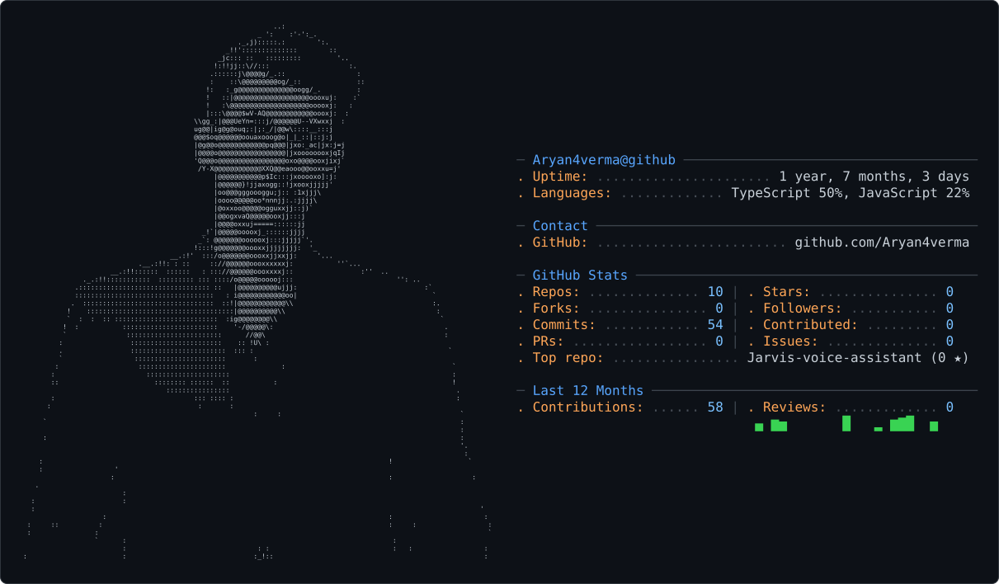

<picture>
  <source media="(prefers-color-scheme: dark)" srcset="dark_mode.svg" />
  <source media="(prefers-color-scheme: light)" srcset="light_mode.svg" />
  
</picture>

<h1>Aryan Verma</h1>

**Computer Science Engineering undergraduate · AI & Data Science · Full-Stack Development**

I build practical software—from real-world business websites to AI-powered applications and developer tools.

[**Projects**](#featured-projects) &nbsp;·&nbsp; [**Tech stack**](#tech-stack) &nbsp;·&nbsp; [**LinkedIn**](https://www.linkedin.com/in/aryan-verma-509678346/) &nbsp;·&nbsp; [**Email**](mailto:verma4aryan4@gmail.com)

Ahmedabad, India &nbsp;·&nbsp; New LJ Institute of Engineering & Technology &nbsp;·&nbsp; Expected graduation: 2028

---

## About me

I'm a computer science student exploring the intersection of **software engineering, applied AI, and product development**. What interests me most is turning complex problems into software people can actually use.

My projects span a client-facing industrial website, an AI-assisted document processing platform built for a national hackathon, and a customized voice AI assistant. I care about the experience on the screen **and** the architecture, validation, and reliability behind it.

## Featured projects

### 01 — [Control-Engineering](https://github.com/Aryan4verma/Control-Engineering)
**Company website · B2B product experience**

Built a website for **Control Engineering MFG**, an industrial valve manufacturing company. The experience helps customers discover products, understand industry-specific applications, and contact the business about technical requirements.

- **Product discovery:** searchable industrial valve catalogue, category navigation, and individual product pages.
- **Business workflows:** product-specific enquiries, contact forms, and administrative screens for managing products and enquiries.
- **Engineering:** responsive React/TypeScript interface, TanStack Start routing, Tailwind CSS, and Supabase integration.

**Stack:** `React` · `TypeScript` · `TanStack Start` · `Tailwind CSS` · `Supabase`

[**Explore the repository →**](https://github.com/Aryan4verma/Control-Engineering)

### 02 — [AI_Land_Record](https://github.com/Aryan4verma/AI_Land_Record)
**Smart India Hackathon 2026 · Team VisionTech · AI-assisted document intelligence**

A hackathon prototype designed to make scanned and difficult-to-read land records **structured, reviewable, and traceable**. Rather than treating an AI-generated answer as automatically correct, it combines extraction with verification and human oversight.

- **Document intelligence:** OCR and AI-assisted extraction of key land-record fields from uploaded documents.
- **Trust and validation:** rule-based checks, confidence assessment, and review pathways for missing or inconsistent information.
- **End-to-end workflow:** a dashboard, role-aware review and approval flows, and audit trails for record decisions.

**Stack:** `Python` · `FastAPI` · `React` · `Tesseract OCR` · `PostgreSQL / Supabase`

[**Explore the repository →**](https://github.com/Aryan4verma/AI_Land_Record)

### 03 — [Jarvis-voice-assistant](https://github.com/Aryan4verma/Jarvis-voice-assistant)
**Voice-first AI · Open-source customization · Human–computer interaction**

Customized and extended an existing open-source JARVIS project into a **Windows-focused, voice-first AI assistant**. The work explores how conversational AI, a futuristic interface, and practical local security can come together in one application.

- **Interaction:** voice and text chat, wake/push-to-talk controls, streaming responses, and interruptible conversations.
- **AI integration:** configurable providers including OpenAI, Gemini, and OpenRouter.
- **Experience and reliability:** holographic 3D interface, protected local API credentials, cancellation-safe interactions, and low-resource rendering options.

**Stack:** `React` · `TypeScript` · `Node.js` · `Three.js` · `AI provider APIs`

[**Explore the repository →**](https://github.com/Aryan4verma/Jarvis-voice-assistant) &nbsp;·&nbsp; [Original JARVIS by Aditya Dewaskar](https://github.com/adewaskar/jarvis)

JARVIS is a modified derivative of the linked open-source project, not an entirely original project. See its repository for attribution and license details.

---

## Tech stack

A focused view of the technologies I work with and continue to develop:

| Area | Technologies |
| :--- | :--- |
| **Languages** | Python · TypeScript · JavaScript · SQL · C/C++ · Java |
| **Frontend** | React · Next.js · TanStack Start · HTML/CSS · Tailwind CSS |
| **Backend & APIs** | Node.js · Express.js · FastAPI · REST APIs |
| **Data & AI** | Data analysis · Machine learning · OCR · LLM integrations · Voice interfaces |
| **Databases & tooling** | PostgreSQL · Supabase · Git/GitHub · Docker · Vite |

These are technologies I have used or am learning; experience varies by tool.

## What I'm learning and building

- **Applied AI:** intelligent document workflows, AI assistants, and useful automation.
- **Full-stack engineering:** better APIs, database design, authentication, testing, and deployment.
- **Computer science fundamentals:** data structures, system design, and writing maintainable software.
- **Product thinking:** balancing user experience, technical constraints, and real business requirements.

I enjoy hackathons, iterating on real projects, and collaborating with builders who like to understand **why** a system works—not just make it run.

## Let's build something useful

I'm interested in **software engineering / AI internships, hackathons, open-source projects, and thoughtful collaborations**.

[**Connect on LinkedIn**](https://www.linkedin.com/in/aryan-verma-509678346/) &nbsp;·&nbsp; [**Email me**](mailto:verma4aryan4@gmail.com) &nbsp;·&nbsp; [**Browse all repositories**](https://github.com/Aryan4verma?tab=repositories)

---

Curiosity → Engineering → Impact.

